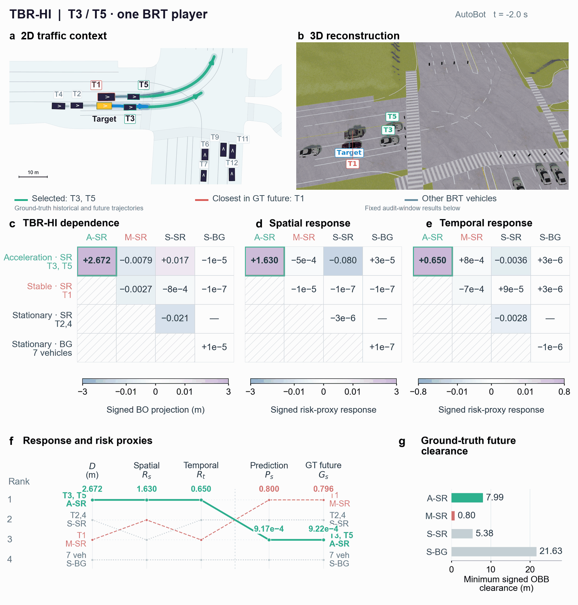
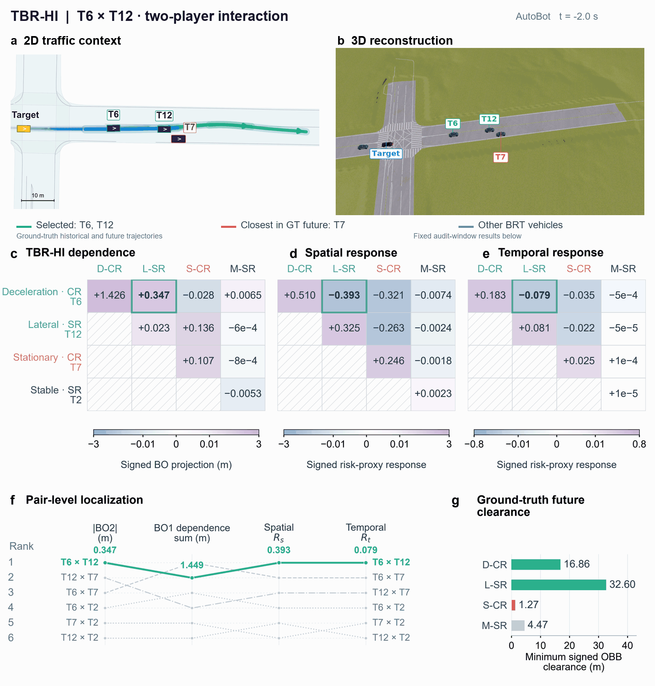

# TBR-HI

**Target-conditioned Behavior–Relevance Harsanyi Interaction**

TBR-HI is a behavior-structured auditing framework for multi-agent trajectory
prediction. It decomposes **model context dependence** and examines whether that
dependence localizes traffic context that drives **surrogate safety responses**.
Both analyses use behavior–relevance–tier (BRT) players: groups of environment
vehicles defined by behavior and target-conditioned physical-relevance tier.

## Representative traffic-scene audit



**AutoBot · one BRT player containing T3 and T5.** This player ranks first in
model context dependence and in both spatial and temporal surrogate safety
response strengths in this scene. T1 has the smallest clearance in the
ground-truth future trajectories.

The upper panels replay ground-truth historical and future trajectories in
synchronized 2D and 3D views. The lower panels show the fixed audit-window
results from the accompanying paper.

<details>
<summary>Additional examples</summary>

**T6 × T12 · cross-behavior interaction (AutoBot).** T6 and T12 belong to two
BRT players with different behaviors. The selected pair ranks first in BO2
dependence and in both surrogate safety response strengths among the evaluated
pairs.



[View the T9 single-player case](assets/traffic-scene-t9.gif).

</details>

## Start here

| Goal | Entry point |
| --- | --- |
| Install the package and see the complete workflow | [Installation and CPU example](#installation) |
| Decompose loss tables you have already computed | [Loss-table example](#decompose-an-existing-loss-table) |
| Connect your own trajectory predictor | [Prediction callbacks](#connect-a-trajectory-predictor) |
| Understand the method and array conventions | [Documentation](docs/README.md) |
| Browse paper, supplementary, and extended results | [Empirical result index](results/README.md) |

## Contents

- Behavior rules, target-conditioned physical relevance, and BRT player construction.
- Conditional-trajectory baseline families with entity matching and kinematic reconstruction.
- Exact minADE coalition games, Harsanyi dividends, and robust aggregation across baselines.
- Single-behavior dependence, dual-behavior interaction, and higher-order joint behavioral dependence.
- Spatial and temporal risk proxies and full-context surrogate safety response operators.
- A CPU example using artificial trajectories and an illustrative predictor.
- Method definitions, input/output contracts, API documentation, and model adapter guidance.
- Readable aggregate result tables and overview figures for eight analysis topics.

The package accepts in-memory trajectories and prediction callbacks. Dataset readers,
dataset preparation, model training, pretrained weights, benchmark runners, and
scene-level statistical-inference pipelines are outside this repository's scope.
The results directory supplies precomputed statistics as Markdown tables and
figures, including readable versions of paper and supplementary results as well
as extended analyses. The [result index](results/README.md) identifies their
correspondence.

## Installation

Requirements: **Python >= 3.10, NumPy >= 1.24, and PyTorch >= 2.0**.
Install from the repository root:

```bash
git clone https://github.com/M-132132/TBR-HI.git
cd TBR-HI
python -m pip install -e .
python examples/synthetic_demo.py
```

If you already have a local checkout, run the last two commands from its root.
The editable installation makes `tbr_hi` importable and uses the declared
dependencies in `pyproject.toml`.

### What the example demonstrates

The example runs on a CPU using artificial trajectories and one deterministic
illustrative predictor. It constructs BRT players, generates a conditional-trajectory
baseline family with the same predictor, evaluates the loss game, and computes
spatial and temporal responses while holding the environment's future fixed.

The terminal output includes:

- The retained player count and requested/actual baseline-family counts.
- Player-level model dependence `D` and spatial/temporal response strengths `Rs`/`Rt`.
- The number of cross-behavior player pairs.
- Across-baseline spatial response variance and the loss-decomposition total.

These artificial-example values illustrate the API; empirical paper results are
provided separately in [results](results/README.md). See
[reproduction scope and environments](docs/reproducibility.md) for the recorded
standalone environment and table conventions.

## Decompose an existing loss table

The table API uses only the Python standard library at import time. This compact
example uses two artificial BRT players and two baseline members; the paper's
main setting uses six actual baseline members with uniform weights.

```python
from tbr_hi import BRTPlayer, decompose_loss_tables

players = [
    BRTPlayer("a", "acceleration", "core_relevant", (1, 2), 0.6),
    BRTPlayer("b", "steady_motion", "candidate_context", (3,), 0.3),
]
# Columns follow bitmask order: empty, {a}, {b}, {a,b}.
# Each row contains minADE losses for one conditional-trajectory baseline.
result = decompose_loss_tables(
    players,
    losses_by_baseline=[[4.0, 3.0, 3.5, 1.5], [4.2, 3.0, 3.6, 1.5]],
    weights=[0.5, 0.5],
    robust_lambda=0.25,
)
print(result["D"])
print(result["behavior_order_two_pair_allocations"])
```

For projected quantities without dividend-detail tables, pass
`include_details=False` to `decompose_loss_tables` or `compute_model_dependence`.
The default keeps all detail fields. Summary mode omits `robust_dividends` and
`member_dividends` while retaining the numerical summaries and checks.

Player `a` contains two environment vehicles; player `b` contains one.
Bit `i` always refers to `players[i]`, so each baseline row must contain all
`2**n` losses in the same player order. A set bit restores that player's
ground-truth history from the conditional-trajectory baseline. The minADE mode
is selected anew for each coalition.

| Dependence output | Meaning |
| --- | --- |
| `D` | Absolute BO1 model dependence keyed by player ID |
| `behavior_order_two_pair_allocations` | BO2 allocations to cross-behavior player pairs |
| `behavior_support_effects` | Contributions organized by distinct behavior support |
| `robust_dividends` | Per-coalition signed mean, population standard deviation, robust dividend, and withheld contribution |
| `member_dividends` | Per-baseline Harsanyi dividends, included in the default detailed mode |
| `scene_order_summary` | BO1, BO2, higher-order dependence, and shrinkage remainder |

BO1 refers to single-behavior support and can involve several same-behavior
players. Behavioral support order counts distinct behavior classes, not the
number of vehicles or players. The [API reference](docs/api.md) defines the
full output structure, including signed allocations and decomposition checks.

## Connect a trajectory predictor

The trajectory interface wraps a caller-supplied model through prediction
callbacks. It uses the following containers:

| Container | Role |
| --- | --- |
| `History` | Ground-truth historical positions, native motion features, masks, timestamps, vehicle slots, and target identity |
| `Prediction` | Target future trajectories `[M,F,2]` and mode probabilities `[M]` |
| `EnvironmentForecast` | Same-model environment predictions, mode probabilities, true anchors, and object identities |
| `BaselineFamily` | Ordered replacement histories, weights, names, and shared vehicle coverage |
| `FutureContext` | Fixed ground-truth future trajectories, masks, headings, and vehicle geometry for the safety proxies |

Use the following sequence:

1. Supply ground-truth histories in one fixed target coordinate frame.
2. Provide `predict_target(history) -> Prediction` and
   `predict_environment(earlier_history) -> EnvironmentForecast` using the
   **same audited model** in evaluation mode.
3. Construct players with `build_players` and baselines with `build_baseline_family`.
   The earlier history ends at the first frame of the replacement window;
   the baseline predictor uses that earlier history to generate the replacements.
4. Retain `family.summary()` with requested/actual member counts and shared coverage.
   The main K=6 setting requires six actual members with uniform weights.
5. Call `compute_model_dependence` with the target's ground-truth future and
   validity mask to evaluate the coalition loss game and its decomposition.
6. Call `compute_safety_responses` with the same players, baseline family, and
   target predictor. Its proxy callback holds environment ground-truth futures fixed.

Player construction separates behavior-label rules (`AnalyzerConfig`),
primary-label families (`BehaviorConfig`), physical-relevance scoring
(`InteractionConfig`) and BRT tier boundaries (`PlayerGroupingConfig`).
The default tier boundaries are 0.40 and 0.25. See
[configuration and parameter meanings](docs/api.md#player-construction-configuration)
for the optional arguments to `build_players` and `group_players`.

The paper uses 21 historical frames at 10 Hz, a baseline history formed by the
true initial anchor plus 20 predicted positions, and the first 40 future frames
for the main loss and safety evaluation. The AutoBot, Wayformer, and EMP-M
baseline-prediction adaptations are documented in
[model adapter guidance](docs/model_adapters.md).

The [input contract](docs/input_contract.md) specifies tensor shapes, coordinate
conventions, unique player IDs, disjoint vehicle groups, finite numeric inputs,
nonnegative weights with positive sum, and valid target evaluation frames.
Whole-player coverage determines retained/excluded players; empty retained
coverage means there are no auditable players.

### Read the response outputs

For each retained player, the response API computes a first-order finite
difference from full-context prediction. For each cross-behavior player pair,
it computes a second-order finite difference. It averages the signed member
responses using normalized baseline weights **before** taking the absolute value.

| Response output | Meaning |
| --- | --- |
| `single` / `pair` | Player and cross-behavior pair response records |
| `member_responses` | Signed finite differences for individual baseline members |
| `signed` / `absolute` | Weighted signed mean and its absolute value |
| `variance` / `std` | Weighted population variance across members and its square root |
| `baseline_summary` | Baseline-family counts, weights, and shared coverage from the trajectory API |

Across-baseline variance describes response variation within the family. It is
distinct from a bootstrap confidence interval. See [method definitions](docs/method.md)
and the [API reference](docs/api.md) for the response equations and proxy callbacks.

## Interpret the quantities

| Symbol | Interpretation |
| --- | --- |
| `D` | Absolute BO1 model context dependence on common valid BRT players |
| `Rs`, `Rt` | Absolute spatial and temporal surrogate safety response strength |
| `Gs`, `Gt` | Risk proxies derived from ground-truth future trajectories |
| `Hs`, `Ht` | Historical exposure measures derived from ground-truth historical trajectories |
| `Ps`, `Pt` | Entity-matched risk proxies of the full-context prediction, used for construct calibration |

The loss game restores ground-truth histories from conditional-trajectory baselines;
the response operation replaces histories starting from the full real context.
They share the model, BRT mapping, and baseline family and evaluate different
objects. They are not statistically independent.

A strong response identifies traffic context that can drive changes in the model's
safety-related outputs. It does not by itself establish high ground-truth future
risk, accident probability, or overall model safety. The core API computes
dependence and response; entity-level G/H/P statistics and localization comparisons
are empirical analyses represented in the result collection.

## Browse empirical results

| Topic | Results |
| --- | --- |
| Behavior structure | [Behavior contributions, occurrence, and support composition](results/01_behavior_structure/README.md) |
| Attribution quality | [Deletion/retention, aligned comparisons, and original-loss validation](results/02_attribution_quality/README.md) |
| Robustness | [Baseline-family, shrinkage, and proxy-parameter analyses](results/03_robustness/README.md) |
| Localization and constructs | [Response localization, BO2 increments, construct relations, and historical exposure](results/04_localization_and_constructs/README.md) |
| Behavior response profiles | [Behavior and physical-tier response profiles](results/05_behavior_response_profiles/README.md) |
| Mismatch and diagnostics | [High-set correspondence, signed responses, and scale diagnostics](results/06_mismatch_and_diagnostics/README.md) |
| Risk and player size | [Traffic-state adjustment and player-size composition](results/07_risk_and_player_size/README.md) |
| Fixed-budget analysis | [Top-100/300/500 results and alternative ranking policies](results/08_fixed_budget/README.md) |

Focused views include [single-vehicle players and candidate-count sensitivity (D12–D14)](results/04_localization_and_constructs/player_count_results.md),
[common analysis sets (D15)](results/04_localization_and_constructs/common_analysis_sets.md),
and [paired BO2 localization increments](results/04_localization_and_constructs/bo2_increments.md).

The attribution-quality view presents Phi as the main TBR-HI representation and
links the additional BO1 results separately. Interpret each estimate together
with its metric-valid scene count, candidate population, evaluation scope,
confidence interval, and paired comparison definition. See
[result definitions](results/DATA_DICTIONARY.md) and the
[paper/supplement correspondence](results/README.md#relationship-to-the-paper-and-supplement).

## Computational scope

For `n` common valid BRT players and `K` baseline members, exact loss-game evaluation
uses `K * 2**n` coalition losses. `compute_model_dependence` accepts an optional
`predict_many` callback for batched model inference. The Möbius inversion step
uses `O(K * n * 2**n)` arithmetic, followed by behavioral-support projection.

The default output includes per-member and per-coalition dividend tables.
`include_details=False` skips their construction and the unused coalition
track-set mapping. Complete losses and dividends remain necessary, so this
option reduces detail-storage overhead while preserving exact coalition evaluation.

For `p` cross-behavior player pairs, each call to `compute_safety_responses` uses
`1 + K * (n + p)` target predictions: one full-context prediction and the single
and pair replacements. Results describe the chosen model, baseline family, and
player space. Exact loss-game evaluation remains exponential in the player count.

## Repository layout

```text
TBR-HI/
├── README.md
├── pyproject.toml
├── src/tbr_hi/
│   ├── __init__.py      # Top-level public API
│   ├── config.py       # Label, family, relevance-score and player-tier parameters
│   ├── interfaces.py   # History, prediction and baseline containers
│   ├── behavior.py     # Behavior labeling and player construction
│   ├── players.py      # BRT groups, scores and coverage
│   ├── relevance.py    # Target-conditioned physical relevance
│   ├── baselines.py    # Conditional-trajectory baseline family
│   ├── coalition.py    # Model callbacks and minADE loss-game evaluation
│   ├── decomposition.py # Public loss-table decomposition
│   ├── projection.py   # Public behavioral-support projection exports
│   ├── _behavior/      # Internal implementation
│   │   ├── features.py
│   │   └── rules.py
│   ├── _decomposition/ # Internal implementation
│   │   ├── coalition_table.py
│   │   ├── robust.py
│   │   └── projection.py
│   └── safety/         # Geometry, risk proxies and safety response operators
├── examples/           # Artificial CPU demonstration
├── assets/             # Animated traffic-scene audits
├── docs/               # Method, input contract, API, adapters, and reproduction scope
└── results/            # Aggregate result tables and overview figures
```
