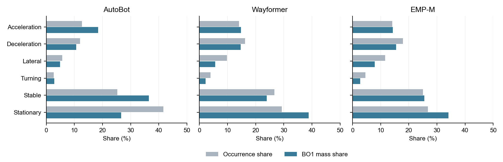

# Selected result tables

[Guide](README.md) · [Data dictionary](../DATA_DICTIONARY.md). Display values are rounded. This page contains selected aggregate results; definitions and analysis scope are given in the guide.

## Behavior occurrence and strength

Source: behavior occurrence and dependence aggregates. Shares are fractions; means are per occurrence.

| model name | behavior id | player occurrence count | player occurrence share | cumulative abs bo1 share | mean abs bo1 | median abs bo1 |
| --- | --- | --- | --- | --- | --- | --- |
| AutoBot | acceleration | 15996 | 0.1272 | 0.1849 | 0.0538 | 0.0018 |
| AutoBot | deceleration | 15073 | 0.1199 | 0.1063 | 0.0328 | 0.0008 |
| AutoBot | lateral maneuver | 7144 | 0.0568 | 0.0488 | 0.0318 | 0.0013 |
| AutoBot | stationary | 52402 | 0.4168 | 0.2666 | 0.0237 | 0.0009 |
| AutoBot | stable motion | 31745 | 0.2525 | 0.3647 | 0.0534 | 0.0017 |
| AutoBot | turning | 3364 | 0.0268 | 0.0287 | 0.0397 | 0.0010 |
| Wayformer | acceleration | 16376 | 0.1405 | 0.1478 | 0.0132 | 0.0003 |
| Wayformer | deceleration | 18945 | 0.1626 | 0.1467 | 0.0113 | 0.0003 |
| Wayformer | lateral maneuver | 11404 | 0.0979 | 0.0561 | 0.0072 | 0.0002 |
| Wayformer | stationary | 34148 | 0.2931 | 0.3879 | 0.0166 | 0.0009 |
| Wayformer | stable motion | 31038 | 0.2664 | 0.2393 | 0.0113 | 0.0004 |
| Wayformer | turning | 4610 | 0.0396 | 0.0222 | 0.0070 | 0.0002 |
| EMP-M | acceleration | 15209 | 0.1408 | 0.1431 | 0.0125 | 0.0014 |
| EMP-M | deceleration | 19333 | 0.1790 | 0.1550 | 0.0107 | 0.0009 |
| EMP-M | lateral maneuver | 12557 | 0.1163 | 0.0784 | 0.0083 | 0.0008 |
| EMP-M | stationary | 28906 | 0.2676 | 0.3411 | 0.0157 | 0.0039 |
| EMP-M | stable motion | 27031 | 0.2503 | 0.2554 | 0.0126 | 0.0016 |
| EMP-M | turning | 4965 | 0.0460 | 0.0270 | 0.0072 | 0.0005 |

## All behavior pairs

Source: behavior occurrence and dependence aggregates. All 15 behavior pairs per model are retained.

| model name | behavior pair id | pair occurrence count | scene count with pair | cumulative abs bo2 share | mean abs bo2 |
| --- | --- | --- | --- | --- | --- |
| AutoBot | acceleration__deceleration | 8804 | 5088 | 0.0282 | 0.0013 |
| AutoBot | acceleration__lateral_maneuver | 4419 | 2859 | 0.0287 | 0.0027 |
| AutoBot | acceleration__stationary | 24525 | 10525 | 0.1164 | 0.0019 |
| AutoBot | acceleration__steady_motion | 19696 | 9075 | 0.1701 | 0.0035 |
| AutoBot | acceleration__turning | 2220 | 1585 | 0.0184 | 0.0034 |
| AutoBot | deceleration__lateral_maneuver | 3787 | 2613 | 0.0133 | 0.0014 |
| AutoBot | deceleration__stationary | 23260 | 10176 | 0.0785 | 0.0014 |
| AutoBot | deceleration__steady_motion | 16999 | 8409 | 0.0830 | 0.0020 |
| AutoBot | deceleration__turning | 2071 | 1491 | 0.0091 | 0.0018 |
| AutoBot | lateral_maneuver__stationary | 12694 | 5814 | 0.0743 | 0.0024 |
| AutoBot | lateral_maneuver__steady_motion | 8518 | 4707 | 0.0446 | 0.0021 |
| AutoBot | lateral_maneuver__turning | 849 | 738 | 0.0029 | 0.0014 |
| AutoBot | stationary__steady_motion | 49895 | 18534 | 0.2688 | 0.0022 |
| AutoBot | stationary__turning | 5543 | 2915 | 0.0347 | 0.0026 |
| AutoBot | steady_motion__turning | 3482 | 2223 | 0.0290 | 0.0034 |
| Wayformer | acceleration__deceleration | 11260 | 6497 | 0.0398 | 0.0007 |
| Wayformer | acceleration__lateral_maneuver | 7185 | 4433 | 0.0302 | 0.0008 |
| Wayformer | acceleration__stationary | 18150 | 9362 | 0.0921 | 0.0010 |
| Wayformer | acceleration__steady_motion | 18010 | 9208 | 0.1195 | 0.0013 |
| Wayformer | acceleration__turning | 3104 | 2235 | 0.0117 | 0.0007 |
| Wayformer | deceleration__lateral_maneuver | 7568 | 4670 | 0.0364 | 0.0009 |
| Wayformer | deceleration__stationary | 20660 | 10286 | 0.1266 | 0.0012 |
| Wayformer | deceleration__steady_motion | 19769 | 10007 | 0.1270 | 0.0013 |
| Wayformer | deceleration__turning | 3490 | 2355 | 0.0077 | 0.0004 |
| Wayformer | lateral_maneuver__stationary | 13849 | 7285 | 0.0978 | 0.0014 |
| Wayformer | lateral_maneuver__steady_motion | 13162 | 6944 | 0.0592 | 0.0009 |
| Wayformer | lateral_maneuver__turning | 1927 | 1505 | 0.0035 | 0.0004 |
| Wayformer | stationary__steady_motion | 34478 | 15309 | 0.2113 | 0.0012 |
| Wayformer | stationary__turning | 5435 | 3259 | 0.0236 | 0.0008 |
| Wayformer | steady_motion__turning | 4520 | 2939 | 0.0137 | 0.0006 |
| EMP-M | acceleration__deceleration | 10240 | 6210 | 0.0401 | 0.0017 |
| EMP-M | acceleration__lateral_maneuver | 6976 | 4509 | 0.0318 | 0.0020 |
| EMP-M | acceleration__stationary | 13813 | 8325 | 0.1314 | 0.0042 |
| EMP-M | acceleration__steady_motion | 13571 | 8002 | 0.0954 | 0.0031 |
| EMP-M | acceleration__turning | 2939 | 2192 | 0.0129 | 0.0019 |
| EMP-M | deceleration__lateral_maneuver | 8549 | 5180 | 0.0297 | 0.0015 |
| EMP-M | deceleration__stationary | 18011 | 9934 | 0.1241 | 0.0030 |
| EMP-M | deceleration__steady_motion | 16791 | 9329 | 0.0944 | 0.0025 |
| EMP-M | deceleration__turning | 3700 | 2511 | 0.0087 | 0.0010 |
| EMP-M | lateral_maneuver__stationary | 12254 | 7248 | 0.0889 | 0.0032 |
| EMP-M | lateral_maneuver__steady_motion | 11732 | 6773 | 0.0503 | 0.0019 |
| EMP-M | lateral_maneuver__turning | 2294 | 1754 | 0.0065 | 0.0013 |
| EMP-M | stationary__steady_motion | 24555 | 13172 | 0.2466 | 0.0044 |
| EMP-M | stationary__turning | 4892 | 3281 | 0.0233 | 0.0021 |
| EMP-M | steady_motion__turning | 3963 | 2792 | 0.0159 | 0.0018 |

## Frequency and cumulative contribution

Occurrence shares and allocated BO1 mass shares, by model. Stable and Lateral denote stable motion and lateral maneuver. These are descriptive aggregates, without inferential error bars. Source: behavior occurrence and dependence aggregates. [Vector PDF](figures/behavior_frequency.pdf).
