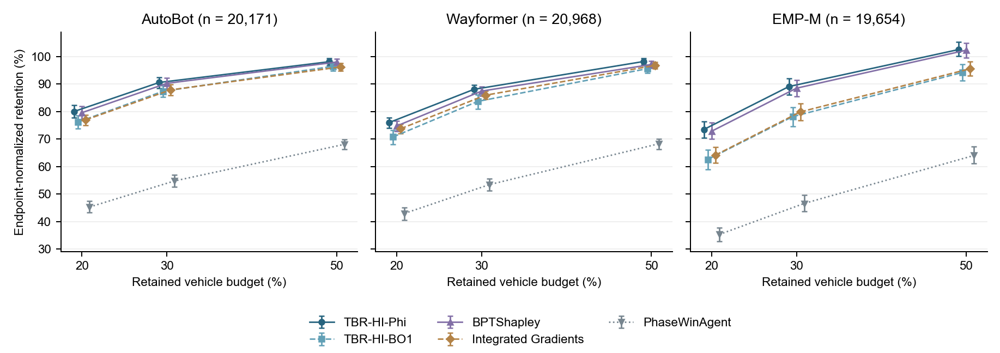

# Additional BO1 representation

[Guide](README.md) · [Main tables](tables.md) · [Definitions](../DATA_DICTIONARY.md)

## BO1 aligned estimates

Supplementary S3b uses Phi to represent TBR-HI. These additional rows retain
the aligned BO1 representation, separate from the original-loss BO1 validation
and the BO1 response-localization task. All have their original metric-valid n.

| model name | method variant | metric name | n | mean | ci low | ci high |
| --- | --- | --- | --- | --- | --- | --- |
| AutoBot | TBR-HI-BO1 | morf_minus_lerf_percent_auc | 20171 | 72.7391 | 70.9179 | 74.5981 |
| AutoBot | TBR-HI-BO1 | morf_minus_random_percent_auc | 20171 | 36.3766 | 35.4070 | 37.3654 |
| AutoBot | TBR-HI-BO1 | sufficiency_retention_percent_0.20 | 20171 | 76.2398 | 73.7592 | 78.6536 |
| AutoBot | TBR-HI-BO1 | sufficiency_retention_percent_0.30 | 20171 | 87.3982 | 85.2427 | 89.5663 |
| AutoBot | TBR-HI-BO1 | sufficiency_retention_percent_0.50 | 20171 | 96.4623 | 94.8006 | 98.0238 |
| Wayformer | TBR-HI-BO1 | morf_minus_lerf_percent_auc | 20968 | 69.5220 | 68.0275 | 71.0668 |
| Wayformer | TBR-HI-BO1 | morf_minus_random_percent_auc | 20968 | 34.7232 | 33.8600 | 35.5329 |
| Wayformer | TBR-HI-BO1 | sufficiency_retention_percent_0.20 | 20968 | 70.7923 | 68.1010 | 73.1744 |
| Wayformer | TBR-HI-BO1 | sufficiency_retention_percent_0.30 | 20968 | 83.7229 | 81.0508 | 86.0991 |
| Wayformer | TBR-HI-BO1 | sufficiency_retention_percent_0.50 | 20968 | 95.6381 | 94.1176 | 97.1141 |
| EMP-M | TBR-HI-BO1 | morf_minus_lerf_percent_auc | 19654 | 59.6567 | 56.9964 | 62.1047 |
| EMP-M | TBR-HI-BO1 | morf_minus_random_percent_auc | 19654 | 30.3411 | 28.8677 | 31.7235 |
| EMP-M | TBR-HI-BO1 | sufficiency_retention_percent_0.20 | 19654 | 62.6105 | 59.0303 | 66.0813 |
| EMP-M | TBR-HI-BO1 | sufficiency_retention_percent_0.30 | 19654 | 78.1634 | 74.7114 | 81.5549 |
| EMP-M | TBR-HI-BO1 | sufficiency_retention_percent_0.50 | 19654 | 94.2585 | 91.3256 | 97.1645 |

## Five-representation retention overview

Scene-equal means and 95% scene-bootstrap intervals (2000 replicates) under the aligned K=1 baseline. Each panel states its metric-valid scene count. Values are endpoint-normalized retention, not prediction accuracy. Source: formal aligned-baseline attribution comparison. [Vector PDF](figures/retention.pdf).

## Paired contrasts

Each difference is left method minus right method on common valid scenes.
Intervals use 2,000 scene-bootstrap replicates; empirical two-sided p uses
centering and the plus-one correction. Source BH q values use all ten method
pairs per model and metric, including BO1. The main page contains 90 contrasts;
the [BO1 extension](additional_bo1.md) contains the remaining 60. Selecting a
display does not recalculate the original testing family. Estimates and
intervals are rounded to four decimals, p/q to six decimals.

### AutoBot

| Metric | Left method | Right method | Paired scenes | Difference | 95% CI | p | BH q |
| --- | --- | --- | --- | --- | --- | --- | --- |
| MoRF − LeRF AUC (%) | TBR-HI-Phi | TBR-HI-BO1 | 20,171 | 3.4833 | [1.9511, 5.3204] | 0.001000 | 0.001249 |
| MoRF − LeRF AUC (%) | TBR-HI-BO1 | BPTShapley | 20,171 | -3.2198 | [-5.2238, -1.7118] | 0.001000 | 0.001249 |
| MoRF − LeRF AUC (%) | TBR-HI-BO1 | IntegratedGradients | 20,171 | -0.3621 | [-2.7049, 1.6117] | 0.737631 | 0.737631 |
| MoRF − LeRF AUC (%) | TBR-HI-BO1 | PhaseWinAgent | 20,171 | 42.9100 | [39.2956, 46.1777] | 0.000500 | 0.001000 |
| MoRF − random AUC (%) | TBR-HI-Phi | TBR-HI-BO1 | 20,171 | 1.6673 | [0.9024, 2.6959] | 0.002999 | 0.004284 |
| MoRF − random AUC (%) | TBR-HI-BO1 | BPTShapley | 20,171 | -1.5823 | [-2.6121, -0.8156] | 0.002499 | 0.004284 |
| MoRF − random AUC (%) | TBR-HI-BO1 | IntegratedGradients | 20,171 | -0.3265 | [-1.5830, 0.7801] | 0.599700 | 0.599700 |
| MoRF − random AUC (%) | TBR-HI-BO1 | PhaseWinAgent | 20,171 | 21.5917 | [19.8862, 23.2747] | 0.000500 | 0.001249 |
| Retention 20% (%) | TBR-HI-Phi | TBR-HI-BO1 | 20,171 | 3.8359 | [2.2518, 5.7529] | 0.001000 | 0.001666 |
| Retention 20% (%) | TBR-HI-BO1 | BPTShapley | 20,171 | -3.3878 | [-5.2887, -1.8138] | 0.000500 | 0.001000 |
| Retention 20% (%) | TBR-HI-BO1 | IntegratedGradients | 20,171 | -0.7836 | [-3.0765, 1.4403] | 0.474263 | 0.474263 |
| Retention 20% (%) | TBR-HI-BO1 | PhaseWinAgent | 20,171 | 30.9212 | [27.6817, 33.8618] | 0.000500 | 0.001000 |
| Retention 30% (%) | TBR-HI-Phi | TBR-HI-BO1 | 20,171 | 3.2030 | [1.5964, 5.0849] | 0.002999 | 0.003748 |
| Retention 30% (%) | TBR-HI-BO1 | BPTShapley | 20,171 | -2.8885 | [-4.8195, -1.2075] | 0.001999 | 0.002856 |
| Retention 30% (%) | TBR-HI-BO1 | IntegratedGradients | 20,171 | -0.5119 | [-2.7446, 1.3017] | 0.626687 | 0.626687 |
| Retention 30% (%) | TBR-HI-BO1 | PhaseWinAgent | 20,171 | 32.6044 | [29.5650, 35.4447] | 0.000500 | 0.000833 |
| Retention 50% (%) | TBR-HI-Phi | TBR-HI-BO1 | 20,171 | 1.6720 | [0.3130, 3.4445] | 0.034483 | 0.049261 |
| Retention 50% (%) | TBR-HI-BO1 | BPTShapley | 20,171 | -1.5420 | [-3.2759, -0.2054] | 0.050475 | 0.063093 |
| Retention 50% (%) | TBR-HI-BO1 | IntegratedGradients | 20,171 | 0.2237 | [-1.6722, 1.7404] | 0.796102 | 0.796102 |
| Retention 50% (%) | TBR-HI-BO1 | PhaseWinAgent | 20,171 | 28.3761 | [25.7409, 30.6827] | 0.000500 | 0.001000 |

### Wayformer

| Metric | Left method | Right method | Paired scenes | Difference | 95% CI | p | BH q |
| --- | --- | --- | --- | --- | --- | --- | --- |
| MoRF − LeRF AUC (%) | TBR-HI-Phi | TBR-HI-BO1 | 20,968 | 4.6723 | [3.1678, 6.3270] | 0.000500 | 0.000625 |
| MoRF − LeRF AUC (%) | TBR-HI-BO1 | BPTShapley | 20,968 | -2.9276 | [-4.4209, -1.3917] | 0.000500 | 0.000625 |
| MoRF − LeRF AUC (%) | TBR-HI-BO1 | IntegratedGradients | 20,968 | -2.0343 | [-3.6050, -0.4432] | 0.009495 | 0.010550 |
| MoRF − LeRF AUC (%) | TBR-HI-BO1 | PhaseWinAgent | 20,968 | 39.3574 | [36.6764, 41.9437] | 0.000500 | 0.000625 |
| MoRF − random AUC (%) | TBR-HI-Phi | TBR-HI-BO1 | 20,968 | 2.3323 | [1.4497, 3.2412] | 0.000500 | 0.000714 |
| MoRF − random AUC (%) | TBR-HI-BO1 | BPTShapley | 20,968 | -1.2983 | [-2.0729, -0.4911] | 0.001999 | 0.002499 |
| MoRF − random AUC (%) | TBR-HI-BO1 | IntegratedGradients | 20,968 | -0.8739 | [-1.6727, -0.0682] | 0.039980 | 0.044422 |
| MoRF − random AUC (%) | TBR-HI-BO1 | PhaseWinAgent | 20,968 | 19.4747 | [18.1247, 20.7625] | 0.000500 | 0.000714 |
| Retention 20% (%) | TBR-HI-Phi | TBR-HI-BO1 | 20,968 | 5.2351 | [3.5721, 7.1742] | 0.000500 | 0.000833 |
| Retention 20% (%) | TBR-HI-BO1 | BPTShapley | 20,968 | -4.0106 | [-5.7617, -2.4294] | 0.000500 | 0.000833 |
| Retention 20% (%) | TBR-HI-BO1 | IntegratedGradients | 20,968 | -2.9856 | [-5.0530, -1.2210] | 0.005997 | 0.006663 |
| Retention 20% (%) | TBR-HI-BO1 | PhaseWinAgent | 20,968 | 27.8102 | [25.3765, 30.0047] | 0.000500 | 0.000833 |
| Retention 30% (%) | TBR-HI-Phi | TBR-HI-BO1 | 20,968 | 4.3859 | [2.7387, 6.4169] | 0.000500 | 0.001000 |
| Retention 30% (%) | TBR-HI-BO1 | BPTShapley | 20,968 | -3.7469 | [-6.1448, -1.8200] | 0.001999 | 0.002856 |
| Retention 30% (%) | TBR-HI-BO1 | IntegratedGradients | 20,968 | -2.2460 | [-4.5749, -0.4010] | 0.037981 | 0.042201 |
| Retention 30% (%) | TBR-HI-BO1 | PhaseWinAgent | 20,968 | 30.2730 | [27.8870, 32.5677] | 0.000500 | 0.001000 |
| Retention 50% (%) | TBR-HI-Phi | TBR-HI-BO1 | 20,968 | 2.5946 | [1.5058, 3.7384] | 0.000500 | 0.000833 |
| Retention 50% (%) | TBR-HI-BO1 | BPTShapley | 20,968 | -1.4971 | [-2.8330, -0.1348] | 0.027486 | 0.034358 |
| Retention 50% (%) | TBR-HI-BO1 | IntegratedGradients | 20,968 | -1.1905 | [-2.3866, -0.1442] | 0.039480 | 0.043867 |
| Retention 50% (%) | TBR-HI-BO1 | PhaseWinAgent | 20,968 | 27.3229 | [25.0162, 29.8018] | 0.000500 | 0.000833 |

### EMP-M

| Metric | Left method | Right method | Paired scenes | Difference | 95% CI | p | BH q |
| --- | --- | --- | --- | --- | --- | --- | --- |
